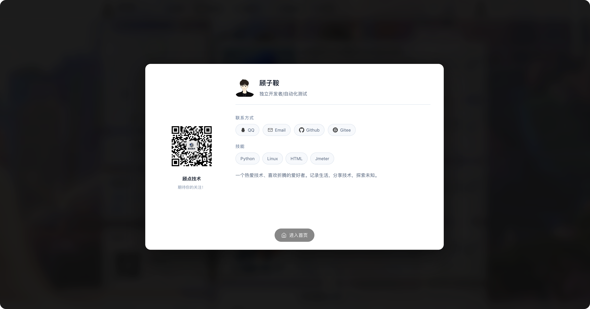
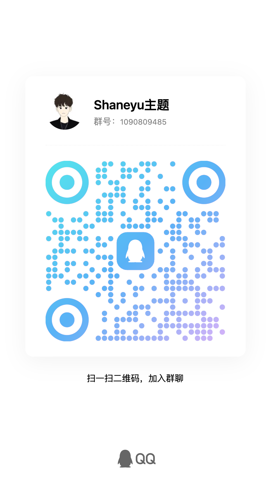

# 🌟 ShaneYu


**一款为开发者打造的现代Halo博客主题**

_专注与极致的开发者博客体验 · 由AI辅助完成全部开发工作_

---

## ✨ 功能特性

### 🎨 界面设计

- 🌙 **深色/浅色主题切换** - 支持自动切换和手动切换，可设置默认配色方案
- 🎨 **自定义主色调** - 可自定义主题主色调，影响全站配色
- 🖼️ **主题背景个性化** - 支持图片/视频壁纸作为主题背景，可分别设置亮色/暗色模式壁纸
- 💎 **毛玻璃效果** - 壁纸模式下全站元素添加半透明磨砂效果
- 📱 **响应式设计** - 完美适配大屏幕、中等屏幕和移动端
- ✉️ **明信片模式** - 全屏明信片展示，支持横向/单叶两种显示模式，含3D翻转动画

### 📝 内容展示

- 📊 **文章数据统计** - 标签页面支持数据统计图表
- 🔍 **搜索功能** - 支持独立搜索页面和快捷键搜索（Ctrl+K）
- 📖 **阅读体验** - 文章详情页支持目录、阅读进度条、回到顶部
- 🏷️ **分类/标签** - 完善的分类和标签系统，支持数据统计
- 📅 **岁月痕迹** - 按时间线展示文章归档
- 💌 **文章翻译** - 一键翻译文章内容（需安装Halo AI Foundation插件）

### 🌐 社交互动

- 📤 **多平台分享** - 支持微信、微博、QQ空间、系统分享
- 👥 **用户系统** - 登录用户显示头像和菜单，支持用户头像展示
- 💕 **情侣卡片** - 侧边栏情侣卡片，记录在一起的美好时光
- 👤 **关于页面** - 独立的About页面模板，包含个人信息、技能、项目、经历
- 📧 **社交链接** - 支持GitHub、QQ、Email、微博、微信、知乎、CSDN、Gitee等

### 🛠️ 技术能力

- 🌐 **多语言支持** - 内置简体中文、繁体中文、English、Español四种语言
- 🎯 **SEO友好** - 语义化HTML结构，支持自定义标题和描述
- ⚡ **高性能** - 基于Vite构建，资源自动压缩和优化
- 🔐 **安全认证** - 支持TOTP两步验证登录
- 🪪 **个人中心** - 个人技能、项目、经历时间线展示
- 🎭 **Iconify图标** - 支持20万+开源图标，可自定义

---

## 🚀 快速开始

### 方式一：后台安装（推荐）

1. **下载主题包** - 前往 [Releases](https://github.com/ZIANGU/ShaneYu/releases) 下载最新版本 `.zip` 文件
2. **进入后台** - 登录Halo后台管理界面
3. **安装主题** - 进入 **外观** → **主题** → **安装主题** → 上传下载的主题包
4. **启用主题** - 安装完成后点击 **启用** 按钮
5. **配置主题** - 进入 **主题设置** 进行个性化配置

### 方式二：开发者模式

```bash
# 克隆仓库
git clone https://github.com/ZIANGU/ShaneYu.git

# 进入项目目录
cd ShaneYu

# 安装依赖
pnpm install

# 开发模式
pnpm dev

# 构建打包
pnpm build
```

构建完成后，主题包位于 `dist/halo-theme-ShaneYu.zip`。

---

## 📸 截图预览

### 🌈 亮色模式


### 🌙 暗色模式


### ✉️ 明信片模式

**明信片正面（媒体展示）**


**明信片背面（站点信息）**



---

## 📚 适配页面

### 📄 文章相关页面

| 页面模板        | 访问路径             | 功能说明                                                         |
| --------------- | -------------------- | ---------------------------------------------------------------- |
| 🏠 **首页**     | `/`                  | 最新文章列表 · 侧边栏组件 · 分页导航 · 明信片模式                |
| 📖 **文章详情** | `/archives/{slug}`   | 封面图 · 元信息 · 目录(TOC) · 阅读进度条 · 点赞评论 · 多平台分享 |
| 🗂️ **分类列表** | `/categories`        | 分类卡片 · 分类下文章数 · 响应式网格布局                         |
| 📂 **分类详情** | `/categories/{slug}` | 分类信息 · 分类下文章列表 · 数据统计图表                         |
| 🏷️ **标签列表** | `/tags`              | 标签云 · 标签热度展示 · 响应式布局                               |
| 🏷️ **标签详情** | `/tags/{slug}`       | 标签信息 · 标签下文章列表 · 数据统计图表                         |
| 📅 **归档页**   | `/archives`          | 岁月痕迹时间线 · 年月分组 · 文章计数                             |

### 👤 个人页面

| 页面模板          | 访问路径   | 功能说明                                                            |
| ----------------- | ---------- | ------------------------------------------------------------------- |
| 👤 **关于页**     | `/about`   | 个人信息 · 联系方式 · 技能展示 · 项目卡片 · 经历时间线 · 多语言支持 |
| 📄 **自定义页面** | 自定义路径 | 支持自定义模板 · 完整HTML内容 · 独立页面样式                        |

### 🔍 功能页面

| 页面模板      | 访问路径   | 功能说明                                              |
| ------------- | ---------- | ----------------------------------------------------- |
| 🔍 **搜索页** | `/search`  | 实时搜索文章 · 搜索结果高亮 · 快捷键(Ctrl+K)唤起      |
| 💬 **瞬间页** | `/moments` | 时间线动态 · 图文/视频/音频支持 · 灯箱预览 · 点赞评论 |
| 🖼️ **相册页** | `/photos`  | 图片分组浏览 · 响应式瀑布流 · 灯箱查看 · 分组筛选     |
| 🔗 **友链页** | `/links`   | 友链卡片 · 分类筛选 · 友链提交表单                    |

### 🔐 用户相关

| 页面模板        | 访问路径          | 功能说明                                   |
| --------------- | ----------------- | ------------------------------------------ |
| 🔐 **登录页**   | `/login`          | 精美登录界面 · TOTP两步验证 · 社交登录入口 |
| 📧 **找回密码** | `/reset-password` | 邮箱重置密码 · 验证码发送                  |

### ⚠️ 错误页面

| 页面模板       | 访问路径  | 功能说明                      |
| -------------- | --------- | ----------------------------- |
| 🚫 **404页面** | `*{path}` | 页面未找到提示 · 返回首页导航 |
| ⚡ **500页面** | -         | 服务器错误提示 · 返回首页导航 |

---

## 🛠️ 技术栈

| 技术                                                                                          | 说明                 | 版本     |
| --------------------------------------------------------------------------------------------- | -------------------- | -------- |
| [Halo](https://www.halo.run/)                                                                 | 强大的开源建站系统   | ≥ 2.20.0 |
| [Thymeleaf](https://www.thymeleaf.org/)                                                       | 服务端模板引擎       | -        |
| [TypeScript](https://www.typescriptlang.org/)                                                 | 类型安全的JavaScript | 5.9.3    |
| [Vite](https://vitejs.dev/)                                                                   | 下一代前端构建工具   | latest   |
| [CSS Variables](https://developer.mozilla.org/zh-CN/docs/Web/CSS/Using_CSS_custom_properties) | 原生CSS变量          | -        |
| [Iconify](https://icon-sets.iconify.design/)                                                  | 20万+开源图标        | -        |

---

## 📖 文档

- [Halo主题开发文档](https://docs.halo.run/developer-guide/theme)
- [Thymeleaf语法参考](https://www.thymeleaf.org/doc/tutorials/3.0/usingthymeleaf.html)
- [Iconify图标集](https://icon-sets.iconify.design)

---

## 💬 加入社区

### 👥 QQ交流群

**群号：1090809485**

扫描下方二维码加入主题交流群，与其他用户分享使用心得：



---

## ❓ 常见问题

### 📥 壁纸不显示？

- 检查图片/视频链接是否有效
- 确认文件格式是否支持（jpg/png/webp/mp4/webm/mov/avi/flv/3gp）
- 清除浏览器缓存后重试

### 📌 侧边栏不显示？

- 在主题设置中确认「显示侧边栏」选项已开启
- 检查浏览器控制台是否有错误

### 🔍 搜索功能不工作？

- 搜索功能依赖Halo的公开API，请确保文章已发布
- 快捷键搜索需要按下 `Ctrl+K`（Mac为 `Cmd+K`）

### 🎨 如何自定义图标？

- 在社交链接设置中，填写Iconify图标名称（如 `mdi:github`）
- 访问 [Iconify图标集](https://icon-sets.iconify.design) 查找更多图标

---

## ⭐ 支持我

如果这个主题对你有帮助，请考虑：

- ⭐ **给个Star** - 在GitHub上点个星，让更多人看到
- 🍴 **Fork** - 克隆仓库进行二次开发
- 💬 **反馈** - 提交Issue或Pull Request改进主题
- 👥 **分享** - 推荐给身边需要的朋友
- ❤️ **点赞** - 给主题点赞鼓励持续更新

**感谢你的每一份支持！**

---

## 📄 License

[GPL-3.0 License](LICENSE)

---

**ShaneYu** - 专注与极致的开发者博客主题
